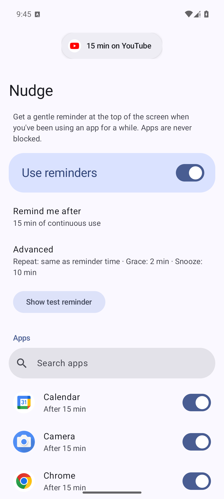
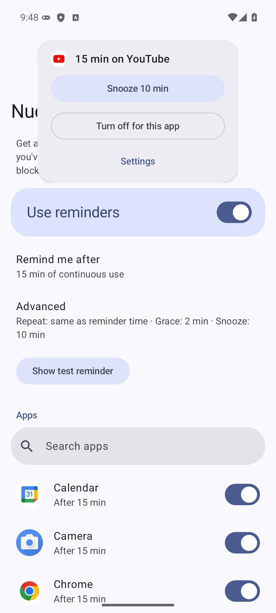
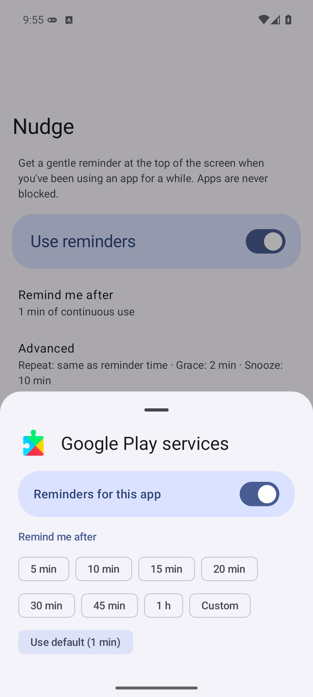
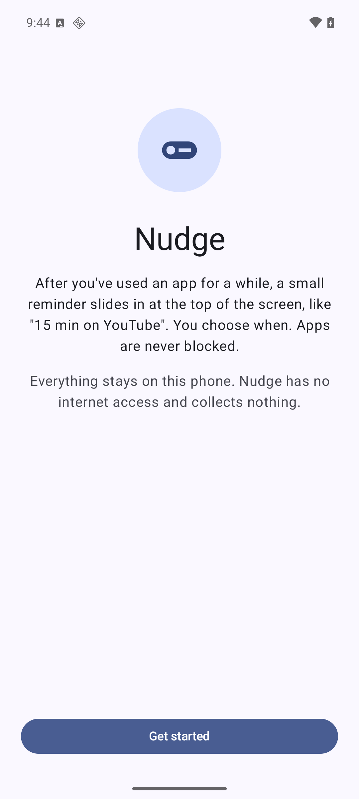
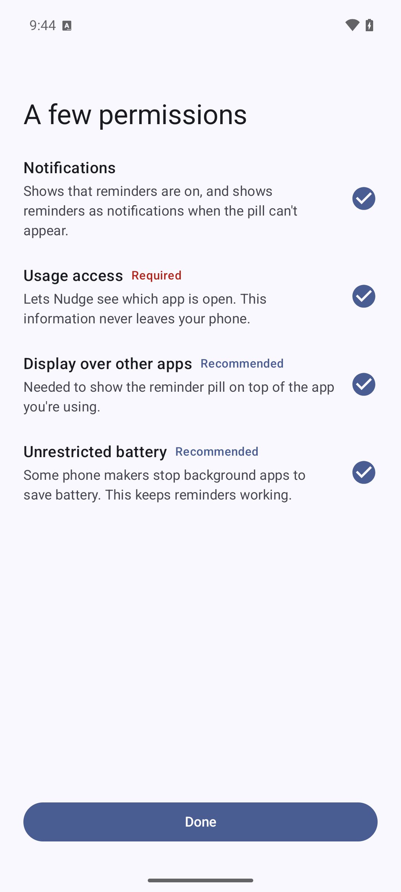
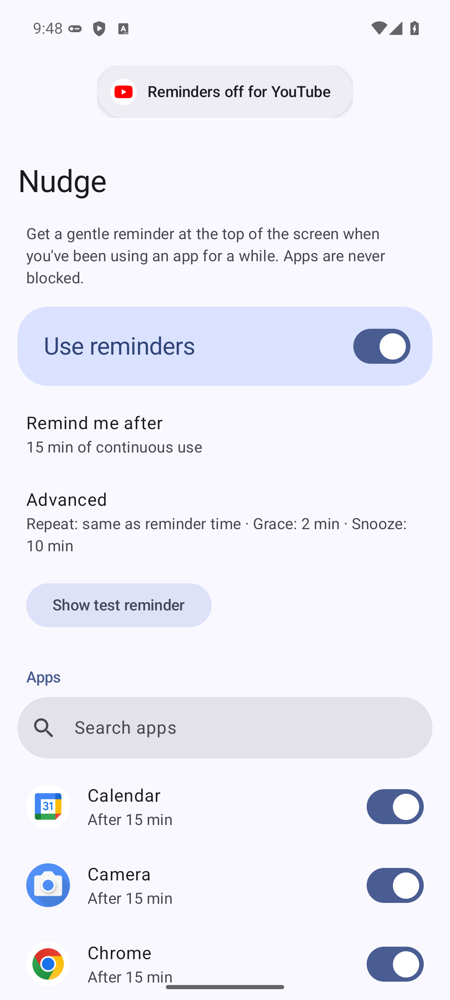
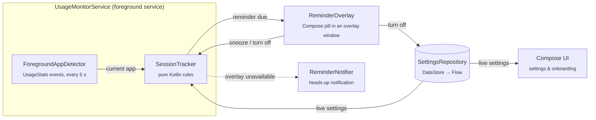

<div align="center">

# Nudge

**Gentle screen time reminders for Android that you set up yourself.**

After you've used an app for a while, a small pill slides in at the top of the screen: *"15 min on YouTube"*.<br>
It never blocks anything. It just lets you know.


&nbsp;&nbsp;
&nbsp;&nbsp;


</div>

---

## Why

Android's Digital Wellbeing has a lovely feature: *screen time reminders*, a quiet pill that tells you how long you've been in an app. But it's only available on some phones, and you can't choose **when** it shows up.

Nudge rebuilds that experience and puts you in control:

- **You choose the apps.** Reminders are opt-in per app; everything starts off.
- **You choose the timing.** A default reminder time (5 min to 1 h, or any custom value), per-app overrides, and how often it repeats.
- **It's forgiving.** Checking a message and coming back within the grace period (2 min by default) continues the same session. Time away isn't counted.
- **It's not in your way.** The pill disappears after 6 seconds, swipes away, and never takes focus from the app you're using.
- **It's private.** No internet permission, no analytics, no backups. Nothing leaves the phone.

## Features

| | |
|---|---|
| **Reminder pill** | Slides in below the status bar with the app's icon and session length ("1 h 5 min on Chrome"). Matches your wallpaper colors and dark mode via Material You. |
| **Quick actions** | Tap the pill to expand it: **Snooze 10 min**, **Turn off for this app**, or jump straight to that app's **Settings**. |
| **Repeat reminders** | Reminds again every N minutes while you keep going (by default, the same as the reminder time). |
| **Snooze** | Silences one app for a while, then reminds you right away if you're still at it. |
| **Notification fallback** | If the overlay isn't allowed, the same reminder arrives as a heads-up notification with the same actions. |
| **Guided setup** | Onboarding explains each permission. The main screen flags anything that's missing. |
| **Survives reboots** | Monitoring restarts after a reboot or an app update. |

<p align="center">
&nbsp;
&nbsp;

</p>

## How it works



1. **Detect.** While the screen is on and unlocked, a foreground service reads `UsageStatsManager` activity events every 5 seconds to work out which app is in front. It stops entirely when the screen turns off.
2. **Decide.** `SessionTracker` owns every rule: sessions, the grace period, thresholds, repeats and snoozes. It's plain Kotlin with an injectable clock, so it's fully unit tested on the JVM.
3. **Remind.** The pill is a Compose UI in a `TYPE_APPLICATION_OVERLAY` window that wraps its content, so touches anywhere else go straight to the app underneath.

## Engineering highlights

- **All the logic is testable.** `SessionTracker` has no Android imports. 21 JUnit tests drive it with a fake clock through real scenarios: thresholds, repeats, grace periods, screen off, snooze ending mid-session, live settings changes and ignored apps.
- **Correct foreground detection.** Tracking "the last resumed package" breaks when an app moves between its own screens: the old screen's *stopped* event arrives after the new one's *resumed* event. Nudge tracks individual activities instead, and reads events in overlapping windows that are safe to process twice.
- **Compose outside an Activity.** The overlay runs Compose inside a service, with its own lifecycle and saved-state owners. The window jumps to its expanded size in one step, instead of re-laying out on every animation frame.
- **Plays by modern Android rules.** A `specialUse` foreground service (and the right fallback on Android 12–13), no `QUERY_ALL_PACKAGES`, immutable PendingIntents, a background activity launch fallback, and settings changes applied live through `Flow`.
- **Lean by design.** No dependency injection framework, no Room, no WorkManager, no AccessibilityService, and nothing beyond AndroidX and Kotlin.
- **Zero warnings.** The Kotlin compiler and Android Lint both report a clean build.

## Tech stack

**Kotlin 2.4** · **Jetpack Compose** with Material 3 and dynamic color · **Coroutines & Flow** · **Preferences DataStore** · **kotlinx.serialization** · **AGP 9.4** with built-in Kotlin and a version catalog · minSdk 31 (Android 12), targetSdk 37

```
app/src/main/java/se/christian/nudge/
├── session/    SessionTracker, duration formatting (pure Kotlin)
├── service/    UsageMonitorService, ForegroundAppDetector, BootReceiver
├── reminder/   ReminderOverlay, ReminderPill, ReminderNotifier, actions
├── settings/   Settings model, SettingsRepository (DataStore)
├── apps/       Launchable apps, labels and icons (cached)
└── ui/         MainActivity, main screen, onboarding, sheets, theme
```

## Getting started

Nudge is a personal, sideloaded app (not on the Play Store).

**Requirements:** JDK 17+ (Android Studio's bundled JBR works), and the Android SDK with Platform 37.2 and Build-Tools 36+.

```bash
./gradlew assembleDebug        # app/build/outputs/apk/debug/app-debug.apk
./gradlew testDebugUnitTest    # SessionTracker unit tests
./gradlew lint
./gradlew installDebug         # install on a connected device
```

Open Nudge, follow the short setup, turn on **Use reminders**, turn on reminders for a few apps, and tap **Show test reminder**.

### Permissions

| Permission | What it's for | |
|---|---|---|
| Usage access | Seeing which app is open | Required |
| Display over other apps | Showing the pill | Recommended (otherwise you get notifications) |
| Notifications | The "reminders are on" notification and the fallback reminders | Recommended |
| Unrestricted battery | Keeping the service alive on phones that kill background apps | Recommended |

On Android 13+, a sideloaded app may need **App info → ⋮ → Allow restricted settings** before usage access and the overlay can be granted. On most devices you can also grant permissions over adb:

```bash
adb shell appops set se.christian.nudge GET_USAGE_STATS allow
adb shell appops set se.christian.nudge SYSTEM_ALERT_WINDOW allow
adb shell pm grant se.christian.nudge android.permission.POST_NOTIFICATIONS
adb shell dumpsys deviceidle whitelist +se.christian.nudge
```

Some phones (for example OnePlus and OPPO) block these adb commands unless **Disable permission monitoring** is turned on in Developer options.

## Known limitations

- **Split-screen and picture-in-picture:** only the most recently resumed app is tracked.
- **Apps that hide overlays** (for example some banking apps) won't show the pill.
- **Aggressive battery management** on some phones can stop the service. Allowing unrestricted battery use helps; some brands also need the app locked in recents or allowed to autostart.
- **Snoozes live in memory** and are cleared if the service restarts.
- **5-second polling** means reminders and app switches can be detected up to 5 s late.

## Documentation

- [SPEC.md](SPEC.md): the product spec, covering detection, session rules, the pill and service lifecycle.
- [.claude/CLAUDE.md](.claude/CLAUDE.md): technical constraints and architecture rules.
- [Decisions](#decisions) below: the non-obvious choices and why they were made.

## Decisions

<details>
<summary>Design and implementation decisions (click to expand)</summary>

- **Reminders are opt-in per app** (changed after the initial build). The original spec enabled every app not listed in `disabledPackages`; settings now store `enabledPackages` instead, and an app gets reminders only if it's in that set. Newly installed apps start off. "Turn off for this app" removes the app from the set. There's no migration from `disabled_packages`, because no build with the old model was installed beyond testing.
- **compileSdk/targetSdk 37 (Platform 37.2).** The current stable AndroidX releases (core 1.19, lifecycle 2.11, Compose 1.12 via BOM 2026.09.00) refuse to build against anything lower.
- **AGP 9 built-in Kotlin.** The `org.jetbrains.kotlin.android` plugin isn't applied; it's declared `apply false` in the root build only to pin the Kotlin Gradle plugin to the same version as the Compose and serialization compiler plugins. The one Gradle deprecation warning in the build (`Configuration.setVisible`) comes from AGP itself.
- **Foreground detection tracks activities, not packages.** Taken per package, moving between two activities of the same app would end the session, because the old activity's `ACTIVITY_STOPPED` arrives after the new one's `ACTIVITY_RESUMED`. Resumed state is kept per package + class, and the foreground app is the package of the most recent still-resumed activity. Each poll re-reads a 2 s overlap, which is safe because processing is idempotent; after more than 10 min without polling, it rescans the last 10 min from scratch.
- **Session clock is `elapsedRealtime`**, so wall-clock changes don't affect sessions.
- **Repeat timing** is measured from when the previous reminder was actually shown (up to one poll after it was due). After a snooze ends, the next repeat counts from the immediate post-snooze reminder.
- **A snoozed session that resets** (away longer than the grace period) does not get the "remind immediately when the snooze ends" reminder; the new session follows the normal threshold, still suppressed until the snooze ends.
- **Ignored packages** (this app, the launcher, System UI) count as "away". The launcher is resolved again each time polling resumes, in case it changed.
- **Usage access check:** `checkOpNoThrow` on API 36+, `unsafeCheckOpNoThrow` below. `unsafeCheckOpNoThrow` is deprecated from API 36, and its replacement was deprecated before 36, so each is used only where it isn't deprecated.
- **Overlay window** uses `fitInsetsTypes = 0` and an explicit `y` from the status bar inset of `currentWindowMetrics`; otherwise the system would also fit it below the status bar and the offset would double. It's created from a window context (`createWindowContext`), the supported way to add windows from a service.
- **The overlay window jumps to its expanded width in one step** when the pill is tapped, instead of wrapping the size animation. A WRAP_CONTENT overlay that follows `animateContentSize` relayouts and re-centers every frame, and on the emulator the window lagged behind and clipped the card.
- **The pill slides in from under the status bar.** The window wraps the pill (so the rest of the screen stays touchable), and the slide is clipped at the window's top edge, which sits at the bottom of the status bar.
- **Test reminder lifecycle:** the test pill shown from the activity uses its own always-resumed lifecycle owner. With the activity's lifecycle, leaving the app within 6 s would pause the Compose frame clock and freeze the pill on screen. The service is its own owner.
- **"Settings" from the pill** starts the activity directly (SYSTEM_ALERT_WINDOW with a visible overlay exempts the app from background activity launch limits). If the activity isn't resumed 2 s later, a notification that opens the app's settings sheet is posted instead. Verified on an Android 16 emulator, where the launch is allowed (`BAL_ALLOW_NON_APP_VISIBLE_WINDOW`).
- **Pill actions reach the service through an in-process `SharedFlow`** (`ReminderEvents`), used by both the pill and the notification's BroadcastReceiver, so snoozes don't need to start the service.
- **The service runs exactly when "Use reminders" is on and usage access is granted.** The activity starts it once the setting has been saved (not on the tap itself), so the service never reads the old "off" value and stops itself.
- **A third notification channel, "Status"** (default importance), is used for "usage access was turned off" and the settings-launch fallback. Neither belongs on the silent "Monitoring" channel or the heads-up "Reminders" channel.
- **On API 31–33** the service is started without a type, since `specialUse` only exists from API 34.
- **No backup:** `allowBackup="false"` and data extraction rules that exclude everything, so settings never leave the phone.
- **Per-app threshold overrides** are stored as a JSON string (kotlinx.serialization) in DataStore, because Preferences DataStore has no map type.
- **UI strings are in Kotlin, not `strings.xml`.** The app is English-only and personal; only the app name is a resource.
- **Main screen title is "Nudge"** rather than "Screen time reminders", to match the launcher label.
- **Visual design** follows Android 16 Settings and Digital Wellbeing: Material 3, dynamic color, a filled main switch, and a `surfaceContainer` pill with a 3 dp shadow. Screenshots in this README were taken on an Android 16 emulator.

</details>
